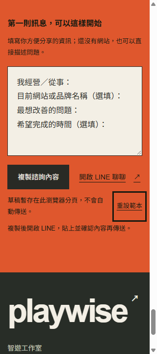
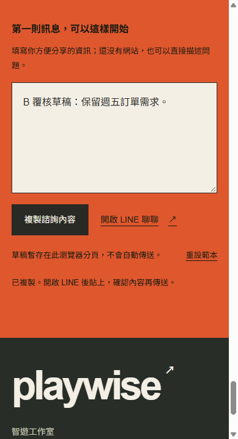

# Assessment B — 修正後定向覆核

**版本**：`ee549b9ae54958d6a9ff7c498725db3c8f5f4330`。**網址**：`http://localhost:3101/`，父任務重新 build/start 的 production server。未讀 A 或 A followup，未修改應用程式。

## 覆核結論

上一份 B 的 **P1 contact 對比、P2 跨情境草稿遺失、P3 手機 logo 高度**，本次均已取得修正後的瀏覽器證據。定向檢查未發現新的 P0/P1/P2 問題。這是指定變更的覆核，不是完整的新一輪 audit，也不將尚未測試的失敗分支說成通過。

| 項目 | 結果 | 直接證據 |
|---|---|---|
| Contact 文字對比 | 通過 | label、help、LINE 連結、草稿提示、重設按鈕與 status 均為 `rgb(22,25,16)` / `#161910`，對 `#df572d` 背景為 **4.691:1**。 |
| 成功／重設狀態對比 | 通過 | 真正操作後讀取 success 與 reset status，均繼承 `#161910`；不再是原先 3.814:1 的 ink。 |
| 輸入框及流程區 | 通過 | textarea 仍為 ink / paper；workflow composer 繼承 board 的 ink，沒有因 contact 修正而誤套橘底色。 |
| 重設目標與焦點 | 通過 | 320 px 的重設按鈕 52×44 px；Tab 可到達，3 px `#161910` outline、offset 6 px；hover 字色保持正確。 |
| 手機品牌首頁 | 通過 | link 144.06×44 px；可存取名稱為「playwise 智遊工作室首頁」，SVG 外層 aria-hidden=true，沒有多餘圖示朗讀。 |
| Contact 草稿 reload | 通過 | 輸入測試文字後 reload，完整保留；重設後 reload，保留的是起始範本。 |
| 情境草稿隔離 | 通過 | 民宿輸入 A、小店輸入 B，切回民宿恢復 A；重設民宿後切回小店，B 仍保留。 |
| 空白內容 | 通過 | 僅空白字元時複製按鈕 disabled。 |
| 服務入口帶入 | 通過 | 按「聊聊工作流程自動化需求」，新增「想了解：工作流程自動化」，原先 contact 草稿仍在，status 說明已帶入並保留。 |
| 390 / 320 響應式 | 通過（本次範圍） | clientWidth / scrollWidth 分別為 375/375、305/305；320 的文字／控制項橫向越界為空陣列，可見目標低於44 px亦為空陣列。 |
| Console | 通過（收錄範圍） | 本次新分頁 warning/error log 為 `[]`。 |

## 實際操作序列

1. 新分頁 390×720：確認品牌 SVG、名稱、44 px 高度，以及 contact 所有文字樣式。
2. contact 填「B 覆核草稿：保留週五訂單需求。」→ 複製 → 出現「已複製。開啟 LINE 後貼上，確認內容再傳送。」。
3. reload 後 textarea 完整保留；點服務諮詢入口後服務名稱加在第一行，原有內容保留。
4. 展開 workflow brief，民宿填「民宿草稿：請保留我輸入的入住需求」，小店填「小店草稿：整理取貨時間」，切回民宿可讀回前者。
5. 重設民宿，textarea 回該情境起始範本並得到焦點；切回小店仍讀回自己的測試草稿，沒有串改。
6. contact 清成空白字元，複製不可用；按重設恢復四行起始範本、status 正確、焦點回 textarea。reload 後仍為範本。
7. 320×720 檢查 hero、contact reset focus 與 workflow reset。重設按鈕在窄版可見、可鍵盤到達，文字有換行空間，未觀察到被裁切。

## 原始碼對照與未測分支

- `studio.module.css:1501` 現在為 `.composer { color: inherit; }`，符合 contact 與 board 分別繼承所在區域色彩的意圖。
- `.brand` 第 99 行 min-height:44px；`.draftOptions button` 第 1636 行 min-height:44px。
- `ConsultationBrief.tsx` 的 sessionStorage 按 id 寫入／讀回；workflow id 改為 `workflow-message-${selected}`，因此切換 remount 後可復原各自草稿。
- clipboard catch 仍會 focus + select textarea 並顯示人工複製指引；與正常 status 共用繼承色。因此**原始碼支持錯誤文案也會使用 4.691:1 的文字色**，但本次**沒有在真實瀏覽器拒絕 clipboard 權限**，不能把它列成已實測成功的拒絕流程。
- sessionStorage throw 時會顯示「此瀏覽器無法暫存草稿，離開前請先複製。」；本次未模擬 storage 拒絕，屬原始碼確認。
- 未傳送 LINE 訊息，未進行正式後端、付款或 OAuth 驗證；未做實體觸控或 200% zoom。
- 父任務另跑 Lighthouse；本次沒有另做效能測試，不更動上份報告的 Performance 暫評。

## Detector 與獨立性

依委派要求**沒有重跑 detector**。沿用本輪唯一一次掃描 `npx --yes impeccable@4.8.0 detect --json app/components/studio app/page.tsx`，其原始掃描版本是 `f2f9552f5d85b979c80831afd5ec790feeaa33a7`，結果保存在上一層 `detector.json`（1 個 Arial overused-font 風格警告）。**該 JSON 不是修正後 ee549b9 的重新掃描結果**；新版本證據僅為本報告的定向人工／瀏覽器覆核。

## 瀏覽器 fallback 與清理

首次嘗試新建 IAB 回覆「Browser is not available: iab」，重新盤點僅列 Chrome，因此以新的 Chrome tab `613536841` 完成覆核，未使用任何既有使用者分頁。使用 tab-scoped CDP viewport，未設 browser-global viewport。所有截圖使用 clip x=0、y=當時 scrollY、寬320或390、高720，不使用全頁拼接。

未嘗試 overlay 注入或另開 server。已清除本分頁的 viewport override 並關閉分頁，父任務 server 保留。沒有讀 A 結果；此報告可在 A followup 完成後才併入父任務。

## 證據

本報告同層 `followup/`：

- `initial-390.json`：logo 名稱、SVG 與幾何；contact 預設實際色彩與尺寸。
- `persistence.json`：contact reload、服務帶入、民宿切換讀回、複製成功色彩。
- `reset-and-empty.json`：重設、焦點、另一情境草稿不受影響、空白停用、重設後 reload。
- `320-focus-responsive.json`：重設焦點與 hover、320 溢位／觸控尺寸。
- `workflow-style.json`、`console.json`、`run-metadata.json`。
- `390-hero.png`、`390-copy-success.png`、`320-hero.png`、`320-contact-focus.png`、`320-workflow-reset.png`。

