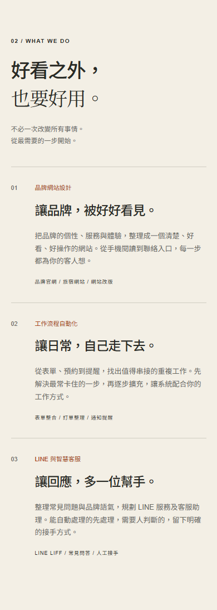
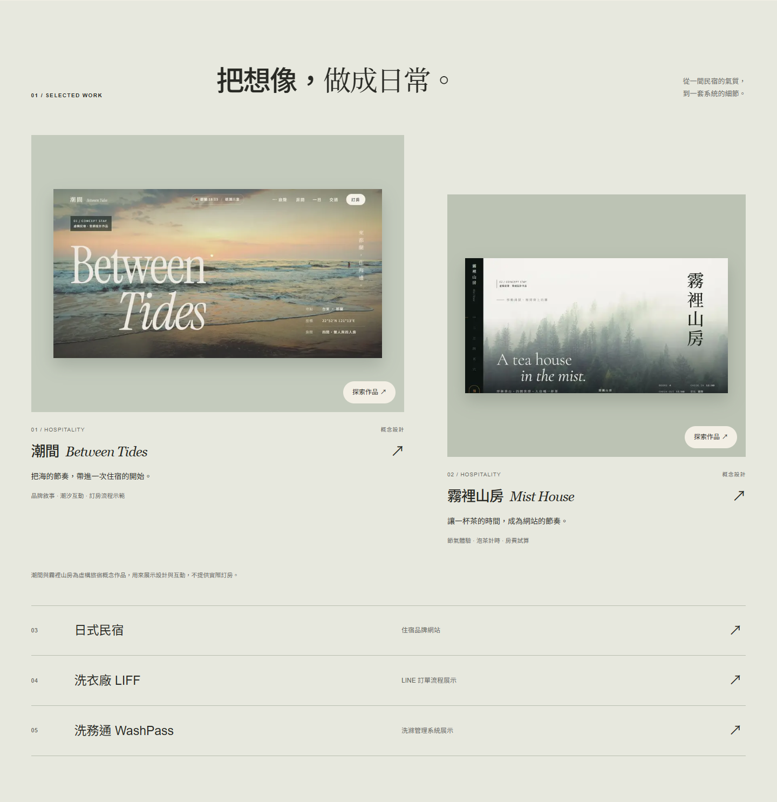

# 智遊官網 Impeccable 設計審查

方法：雙子代理獨立評估，A 為 `/root/impeccable_design_a`，B 為 `/root/impeccable_evidence_b`。A 完成設計判斷前，未向 A 或綜合評估者提供 B 的偵測結果。

**結論：目前是有一致風格、基本操作良好的工作室官網，但還不足以據此宣稱已達得獎級品質。** 最值得改善的是手機閱讀、服務與作品的對應，以及從閱讀到諮詢的銜接。上一輪發布驗收證明了部分工程品質，對整體設計完成度的判斷過於樂觀；本次補上不同方法的交叉檢查。

## 範圍與方法

- 2026 年 10 月 29 日，正式網址 `https://playwise-nine.vercel.app/`。
- 原始碼版本 `eb9dcb1`，應用程式發布版本 `7f6be41`；穩定目標 `app/page.tsx`，主要實作 `app/components/studio/`。
- 主頁定位為 Persuade，作品區為 Experience；首頁全區域審查，抽查潮間與日式民宿的品牌與返回路徑。不是所有作品功能的完整驗收。
- [Impeccable 原始專案](https://github.com/pbakaus/impeccable)，CLI 4.8.0；參考原始碼 revision `5e745ace7e151feb2a93d360d0281fe39448b857` 的 [critique](https://github.com/pbakaus/impeccable/blob/5e745ace7e151feb2a93d360d0281fe39448b857/skill/reference/critique.md) 與 [audit](https://github.com/pbakaus/impeccable/blob/5e745ace7e151feb2a93d360d0281fe39448b857/skill/reference/audit.md) 方法。
- 分數是代理按框架做的啟發式評估，非真人研究、轉換率實驗、工具認證或獎項評審分數。

## 設計特異性

「把日常理順」的前後互動最貼近智遊的服務，也比純裝飾動畫有意義。米白、橘色、深綠與排版形成一致視覺；但大字、襯線點綴、抽象線結與英文字眉仍是可套用到其他設計工作室的語彙。「宜蘭出發」主要停留在文字與地址，還沒有化為更具體的內容選材。

下一步應放大對小型經營者日常的理解，讓一個真實問題、對應流程與可看的示範成為主角，而不是再堆更多裝飾或動畫。真實成果須有來源，概念展示須維持標示。

## 設計與易用性評分

| Nielsen 面向 | 分數 0–4 | 主要依據 |
|---|---:|---|
| 狀態回饋 | 3 | 情境、按鈕、展開狀態有回饋；導覽沒有所在區域提示。 |
| 符合使用者語言 | 3 | 多數貼近店家日常，LIFF 等縮寫仍需解釋。 |
| 控制與返回 | 3 | 可還原示範、Escape 關選單，作品有返回路徑。 |
| 一致性 | 3 | 首頁一致；bnb 概念標示與各作品返回命名有落差。 |
| 錯誤預防 | 3 | 示範與實際服務有區分，但重要說明過小。 |
| 辨識而非回憶 | 3 | 文字入口清楚；服務與作品缺少就近對應。 |
| 專家效率 | n/a | 行銷與作品展示無批次操作需求，不因沒有快捷鍵扣分。 |
| 美感與精簡 | 3 | 視覺有秩序；手機留白與裝飾取得的空間多於重要文字。 |
| 錯誤恢復 | 2 | 複製失敗提示指向「下方」，需求文字實際在上方。 |
| 協助與引導 | 2 | 有 FAQ 與合作步驟，首次諮詢的起手式仍不具體。 |
| **綜合** | **25/36，69.4%，需改善** | 9 項適用。A 原評 26/36；合併 B 的錯誤指引證據後，錯誤恢復由 3 調為 2。 |

認知負荷檢查為 **1/8 未通過，整體低負荷**：主要問題是訪客必須記住前面的作品，再自行對應後面的服務。五個作品有兩主打加三次要的分層，不將總數超過四個直接判為資訊過載。

## 技術稽核評分

| 面向 | 分數 0–4 | 主要依據 |
|---|---:|---|
| 可及性 | 3 | 鍵盤、焦點與語意有基礎；hover 小字對比不足。 |
| 效能 | 3 | 輕量實作與圖片最佳化；本次未重新量測正式站效能。 |
| 樣式 token | 2 | 有基礎變數，區段色彩仍多處寫死；不因沒有深色模式扣分。 |
| 響應式 | 3 | 四種寬度無水平溢出；小字與部分觸控尺寸可改善。 |
| 實作完整性 | 3 | 示範邊界清楚；複製失敗指引有方位錯誤。 |
| **合計** | **14/20，Good** | 與設計評分、Lighthouse 分數分開解讀。 |

## 五個優先問題

### P1 導覽滑過後的小字對比不足

**實測問題。** 桌機導覽為 13px，hover 字色 `#d7491b`、背景 `#f3efe5`，對比約 **3.76:1**。一般文字應至少 4.5:1，且 hover 狀態也適用；來源為 [W3C 1.4.3 說明](https://www.w3.org/WAI/WCAG22/Understanding/contrast-minimum.html)。同一橘色用於大標題並不因此違規。

- 位置：`app/components/studio/studio.module.css:109`。
- 影響：低視力使用者在 hover 時反而較難讀取導覽。
- 修正：改用較深橘色，或保留墨色加底線；用 `impeccable harden` 處理後重測。

### P2 手機重要資訊像註腳

**量測加設計判斷。** 390px 下，概念標記 9px、概念說明 10px、服務正文 13px、細項 9px、諮詢文字 11px。這些都是判斷服務與案例性質所需的內容，不只是裝飾；小字本身不直接等於 WCAG 違規。

- 位置：`studio.module.css:599`、`:1079`、`:1095`、`:1133`、`:1136`、`:1175`。
- 影響：手機店家掃讀時容易只看見標題，漏掉實際範圍與限制。
- 修正：正文先以 15–16px、操作與重要說明以 13–14px 為起點，回收部分裝飾留白；用 `impeccable adapt`，並重驗 320px。

### P2 旅宿美感有證據 自動化能力缺少同等展示

**設計判斷。** 兩張旅宿概念圖主導作品區，洗衣與系統作品只剩文字列。服務介紹又沒有連到相關示範，訪客必須自己推斷哪些作品證明哪些能力。

- 位置：`StudioHome.tsx:105` 起、`:168` 起、`:199` 起。
- 影響：網站容易被理解為旅宿形象網站工作室，弱化「懂日常的系統」定位。
- 修正：讓一個流程作品具備清楚的問題、操作畫面與示範範圍；每項服務連到相關作品。bnb 在首頁也應標為概念，與內頁一致。用 `impeccable clarify` 與 `impeccable bolder`，不編造成效數字。

### P2 服務閱讀與諮詢開始之間有斷點

**設計判斷。** 三個服務列沒有就近行動入口；場景諮詢模板藏在折疊區，末端 LINE 邀請沒有帶出這個模板。手機讀完合適的服務後還得再找入口，到 LINE 前仍要自己想第一句話。

- 位置：`StudioHome.tsx:203` 起、`:318` 起；`WorkflowPlayground.tsx:129` 起。
- 影響：增加已經有需求的訪客開始聯絡的負擔；未量測流失率。
- 修正：在服務區增加輕量諮詢入口，末端補「先傳現有網站／你的生意，以及最想改善的一件事」。沿用已存在的模板；不捏造回覆時效或價格。用 `impeccable clarify`，必要時 `impeccable onboard`。

### P2 複製失敗訊息指錯方向

**程式與 DOM 確認。** catch 文案是「請選取下方文字後複製」，需求段落卻在上方。成功路徑已操作；沒有強迫觸發權限拒絕，因此錯誤分支依程式與 DOM 順序判斷。

- 位置：`WorkflowPlayground.tsx:46`、`:133`–`:142`。
- 影響：使用者無法自動複製時，依提示往下找不到內容；文字本身仍保留。
- 修正：改成「請選取上方的需求文字後複製」，或使用清楚標示的可選取欄位。用 `impeccable clarify`／`impeccable harden`。

## 值得保留的部分

1. 線結、理順文案與前後流程互動，已有相互呼應的主題；互動同時改變文字和狀態，具有解釋作用。
2. 服務語氣貼近小型經營者，保留人工接手、先確認範圍再報價等邊界；不需要改成技術術語堆砌。
3. 原生 details、skip link、焦點、可逆狀態、圖片 alt 與概念揭露具體可用；抽查作品確實有返回路徑。

## 訪客情境與情緒旅程

- **Jordan，第一次找網站協助：** 能理解服務對象，但 LIFF 與自動化能力證據仍需自行理解；最終不知道第一則訊息應包含什麼。
- **Casey，忙碌的手機店主：** 沒有水平溢出，卻要讀 9–13px 的服務與範圍資訊；讀到服務時沒有就近入口。
- **Riley，會核對承諾的訪客：** 兩個主打標示概念，bnb 在首頁卻未同步標示；正式成效與概念展示應始終分清楚。

情緒旅程是「舒服的首屏 → 有美感的作品 → 服務小字形成低谷 → 日常互動重新建立理解 → 醒目但起手式不足的聯絡邀請」。應縮短中段閱讀與末段行動的落差。

## 次要觀察與偵測器結果

- **P3：觸控區。** 選單與場景按鈕約 43px，諮詢 summary 約 39px，部分頁內入口約 31.5px；可補至 44px。已量測目標仍至少 24×24px，不將未達 44px 誤當 WCAG AA 違規。
- **P3：色彩 token。** 深色區段、流程狀態與卡片仍多處直接寫色值，維護對比時容易漏改；用 `impeccable extract` 整理語意 token。
- 一次 `impeccable detect --json app/components/studio app/page.tsx` 只回報 **1 個 warning：`overused-font`**，位於 `studio.module.css:9` 的 Arial。這是字型風格提示，不是整站模板化的證明；中文還有字型回退，標題也有襯線字體。未升格為確認缺陷。
- 上述 hover 對比、小字與錯誤文案都由人工核對補出。偵測器只回報一項，不代表網站只有一個問題。

綜合確認與設計建議為 **P0 0、P1 1、P2 4、P3 2**。不是七項都屬於標準違規。

## 證據與限制

獨立原始報告：[Assessment A](evidence/impeccable-20261029/assessment-a.md)、[Assessment B](evidence/impeccable-20261029/assessment-b.md)。另保留 [detector 原始 JSON](evidence/impeccable-20261029/source-detector.json)、[尺寸與控制項量測](evidence/impeccable-20261029/verified-metrics.json)、[對比資料](evidence/impeccable-20261029/contrast-results.json) 及 [減少動態檢查](evidence/impeccable-20261029/reduced-motion.json)。完整工作截圖在 repo 的 `output/impeccable-review-20261029/a/` 與 `b/`。

這次以桌面 Chromium 模擬不同視窗並使用鍵盤／滑鼠驗證；未測實體手機觸控、Safari、完整螢幕閱讀器或 200% 文字縮放。既有 Lighthouse 99/100/100/100 只作歷史本機工程佐證，沒有重新量測正式站，也沒有用它換算設計分數。

## 後續方向

建議先 `impeccable harden` 修正對比，再 `impeccable adapt` 處理手機閱讀，接著 `impeccable clarify` 串起服務、證據與諮詢；最後 `impeccable polish` 統一細節。此輪僅審查，未修改應用程式或重新部署。

待使用者選擇：優先改善手機諮詢、能力證據，或品牌辨識；修改範圍可為對比與文字問題、五項優先問題，或再含兩項 P3。
