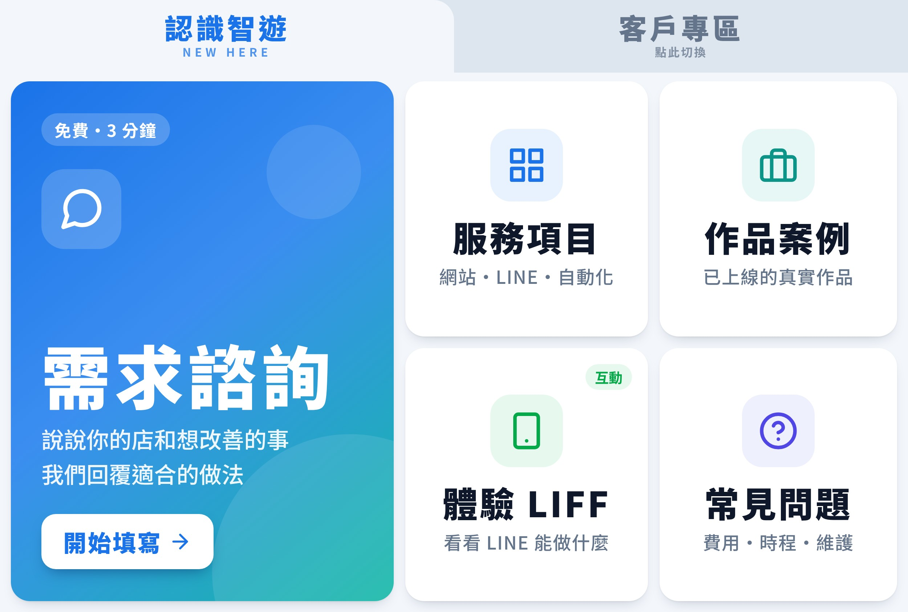
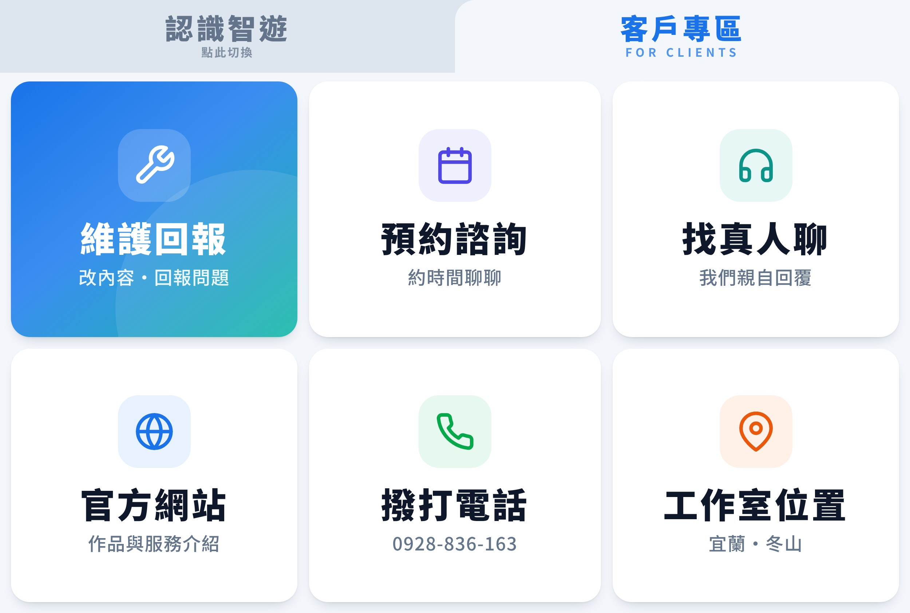
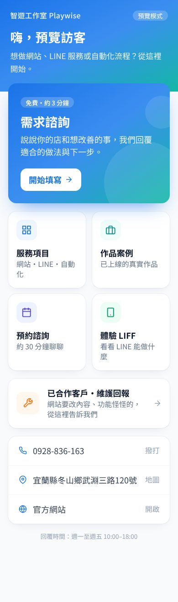
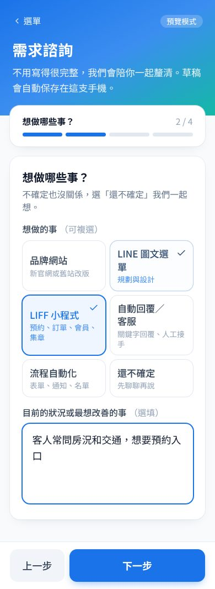
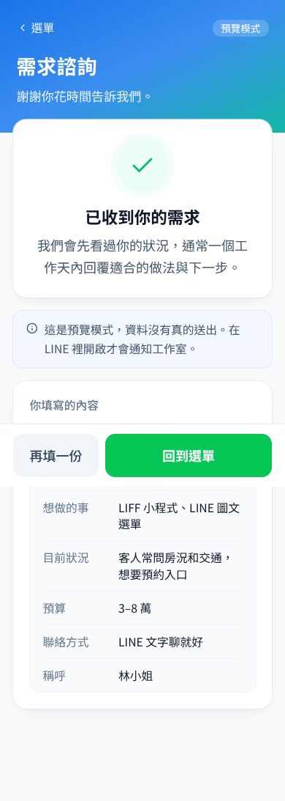
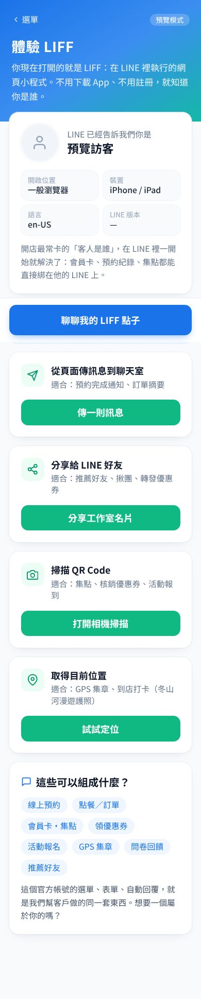

# 智遊工作室 LINE 官方帳號：圖文選單＋LIFF 規劃（2026-11-25）

上線步驟見 [line/README.md](../line/README.md)。

## 目標

1. **把客人的詢問收成結構化的需求**：不再從「你好，想問一下」開始來回問，客人 3 分鐘填完，工作室直接拿到經營類型、想做的事、預算、時程與聯絡方式。
2. **官方帳號本身就是作品**：工作室的服務之一就是幫客戶做 LINE 圖文選單與 LIFF，所以自己的帳號要做到「客人用過就懂我們能做什麼」，包含頁籤式選單、LIFF 表單、Flex 卡片、自動回覆與真人接手。
3. **照顧已合作的客戶**：維護需求、內容修改不再散落在聊天裡，有一個固定入口。

## 兩種人，兩個頁籤

| 頁籤 | 給誰 | 他最想做的事 |
|---|---|---|
| A 認識智遊（預設） | 新朋友、潛在客戶 | 搞懂你們做什麼 → 看作品 → 開口問 |
| B 客戶專區 | 已合作的客戶 | 回報問題、約時間、找到人 |

用 LINE 的 `richmenuswitch`（rich menu alias）做頁籤，點上方就能切換，不需要後端判斷身分。

### 圖文選單 A：認識智遊



| 格子 | 動作 | 為什麼 |
|---|---|---|
| **需求諮詢**（左側大格） | LIFF `/inquiry` | 最重要的轉換，給最大的面積與唯一的彩色格 |
| 服務項目 | LIFF `/services` | 服務＋合作流程＋常見問題，一頁看完 |
| 作品案例 | postback → 聊天室跳出作品輪播卡 | 有截圖的卡片在聊天室裡最直觀，也示範 Flex Message |
| 體驗 LIFF | LIFF `/demo` | 讓客人親手試 LIFF 能做什麼（取得身分、傳訊息、分享、掃碼、定位） |
| 常見問題 | postback → 快速回覆選單 | 費用、LIFF 是什麼、圖文選單、維護等，點了就答 |

### 圖文選單 B：客戶專區



| 格子 | 動作 |
|---|---|
| **維護回報** | LIFF `/support`：選專案、類型、急迫度、說明 |
| 預約諮詢 | LIFF `/booking`：選平日日期、時段、會議方式 |
| 找真人聊 | postback → 回覆「已通知」＋推播通知工作室 |
| 官方網站／撥打電話／工作室位置 | 直接開網址、`tel:`、Google 地圖 |

設計沿用官網 A 版的藍白卡片風格（`#1a73e8` → teal 漸層、Noto Sans TC、react-icons Feather 圖示），選單與網站、LIFF 是同一套視覺。圖片由 `line/richmenu/render.mjs` 依 `layout.mjs` 產生，點擊範圍與圖上格子共用同一份座標。

## LIFF 頁面

一個 LIFF app（Endpoint `/liff`），用路徑區分功能：`liff.line.me/{LIFF_ID}/inquiry` → `/liff/inquiry`。

| 頁面 | 內容 |
|---|---|
| `/liff` | 首頁：用 LINE 名稱打招呼、需求諮詢主按鈕、各功能入口、電話地址 |
| `/liff/inquiry` | 4 步驟：經營類型 → 想做的事（可複選）→ 預算時程（選填）→ 聯絡方式＋送出前確認。草稿存在手機，從 Flex 卡片的「諮詢這項服務」進來會預先勾選 |
| `/liff/booking` | 未來 3 週平日、4 個時段、LINE 通話／Meet／到工作室 |
| `/liff/support` | 已合作專案清單＋其他、內容修改／功能異常／新增功能／帳務、急迫度（緊急時提示電話） |
| `/liff/services` | 三大服務、合作流程、常見問題 |
| `/liff/cases` | 真實案例（宜蘭旅遊通、衿日林、冬山河漫遊護照）＋可試玩的示範 |
| `/liff/demo` | 體驗 LIFF：顯示 LINE 身分與環境、傳訊息到聊天室、shareTargetPicker 分享名片、掃 QR Code、定位 |

沒有設定 LIFF ID 或網址加 `?preview=1` 時是**預覽模式**：一般瀏覽器也能看畫面、走完流程，但不會送出。也可以當作業務簡報時的展示。

| 首頁 | 需求諮詢 | 送出完成 | 體驗 LIFF |
|---|---|---|---|
|  |  |  |  |

## 客人送出表單後發生什麼

```
客人在 LIFF 按送出
 ├─ ① liff.sendMessages：把「【需求諮詢】…摘要」以客人名義送進聊天室
 │     └─ Webhook 認得【需求諮詢】開頭 → 回覆「✅ 已收到」卡片（reply，免費）
 ├─ ② POST /api/liff/submit（帶 LIFF ID token）
 │     ├─ 向 LINE 驗證 token，確認是哪位使用者（不能偽造）
 │     ├─ 推播「📥 新的需求諮詢」卡片給 LINE_ADMIN_TO（你或工作室群組）
 │     ├─ 選填：轉送 Google 試算表當客戶名單
 │     └─ 若 ① 失敗（例如從外部瀏覽器開啟），改推播「已收到」給客人
 └─ 完成頁顯示填寫內容
```

兩條路有一條成功就算送出成功：聊天室裡一定有紀錄，工作室在 OA Manager 就能接著回。

## 自動回覆原則

**只回答明確的問題，其他留給真人。** 官方帳號開「聊天＋Webhook」模式，工作室仍在 OA Manager 親自回覆；機器人只處理下列情境，不會對一般聊天自動回話，避免打斷真人對話。群組裡不做關鍵字回覆。

| 觸發 | 回覆 |
|---|---|
| 加入好友 | 歡迎卡（用 LINE 名稱打招呼）＋需求諮詢、體驗 LIFF 按鈕＋快速回覆 |
| 服務、項目、你們做什麼 | 服務輪播卡（每張可直接「諮詢這項服務」） |
| 作品、案例 | 作品輪播卡（有截圖） |
| 費用、價格、報價、多少錢 | 常見問題：費用怎麼估 |
| LIFF／圖文選單／維護 | 對應的常見問題 |
| 常見問題、FAQ | 快速回覆選單 |
| 電話、地址、在哪 | 聯絡卡（撥打、地圖） |
| 真人、客服、專人 | 回覆已通知＋推播通知工作室 |
| `【需求諮詢】`等表單摘要 | 「已收到」卡片 |
| `#myid` | 回覆自己的 userId（設定通知用；設定好後只回給管理員） |

每則回覆底下都有快速回覆（填需求、服務、作品、費用、常見問題、找真人），對話不會斷在那裡。

## 檔案

```
app/lib/line/content.ts   工作室資訊、服務、案例、常見問題（改文案改這裡）
app/lib/line/forms.ts     表單選項、驗證、摘要格式（前後端共用）
app/lib/line/flex.ts      Flex Message 與快速回覆
app/lib/line/server.ts    LINE API（reply/push/驗簽/驗 ID token/轉送）
app/api/line/webhook      Webhook
app/api/liff/submit       表單送出
app/liff/                 LIFF 頁面
line/richmenu/            圖文選單版面、產圖、上傳腳本與圖片
```

不依賴 LINE 的 Node SDK（直接 fetch），只新增 `@line/liff`。

## 驗證（2026-11-25，本機 production build）

- `next build` 通過；LIFF 7 個頁面為靜態頁，2 個 API 為動態。
- 圖文選單：兩張圖 283 KB／244 KB（上限 1 MB）；點擊範圍逐像素檢查無遺漏、無重疊。`setup.mjs --dry-run` 輸出 JSON 正常（有 token 時會再呼叫 LINE 的 validate API）。
- Webhook（`LINE_API_DRY_RUN=1`）：加好友、服務、費用、表單摘要、常見問題、作品、找真人等 8 種情境有回覆；一般聊天、切換頁籤、非管理員的 `#myid` 不回覆；找真人會推播通知管理員；錯誤簽章回 401。
- 表單 API：合法資料通知成功；30 秒內重複送出被擋；缺必填回 422；非法選項（例如 needs 裡的 `hack`）會被濾掉；未知類型與壞 JSON 被拒絕。
- LIFF（iPhone 13 尺寸、預覽模式）：走完需求諮詢 4 步驟到完成頁；維護回報草稿重新整理後仍在；預約選日期與時段；無 console 錯誤、無水平捲動。

**尚未驗證**（需要正式的 channel 與手機）：真實 LINE App 內的 LIFF 登入、`sendMessages`、`shareTargetPicker`、`scanCodeV2`，以及 Flex 訊息在 LINE 上的實際外觀。上線後照 `line/README.md` 的檢查清單點一遍。

## 之後可以加

- **把已合作客戶直接綁到「客戶專區」**：用 `POST /v2/bot/user/{userId}/richmenu/{id}`，客戶一打開就是 B 頁籤。
- **預約接 Google 日曆**：顯示真正有空的時段，確認後自動建立會議。
- **需求單狀態**：試算表的「狀態」欄改成「已回覆／報價中／成交」，之後可做簡單的追蹤。
- **選單成效**：在 LIFF 網址加 `?src=richmenu`，搭配 LINE 官方帳號的選單點擊統計，看哪一格最常被點。
- **作品集**：把這套做成「LINE 官方帳號升級方案」的範例，放到官網作品區。
