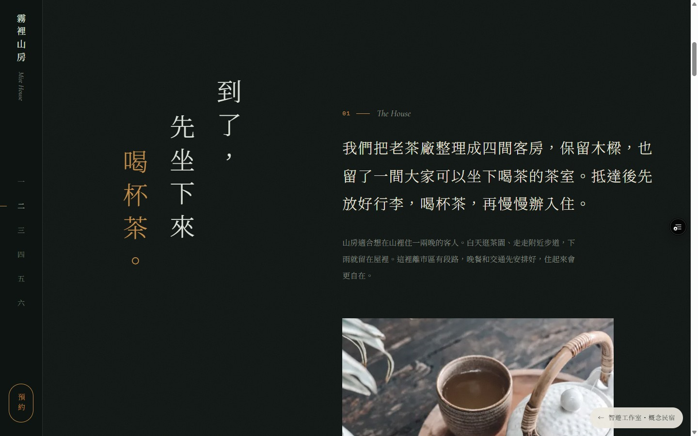

# 旅宿文案修訂與預覽驗收

2026-10-28，接續第一輪視覺與效能改善，依使用者「有些文案太像 AI、不像旅宿業」的回饋，重寫兩站介紹、房型、餐食、行程、節氣提示與詢問對話。

程式版本：`1d46367e9bc75e2570e155762614d548b0ba355e`。已推至原分支及 [草稿 PR #1](https://github.com/JasonLinn/playwise/pull/1)，未合併 main。

已驗收的 Preview：

- [潮間](https://playwise-58h5kp6c2-jasonlinns-projects.vercel.app/works/tide)
- [霧裡山房](https://playwise-58h5kp6c2-jasonlinns-projects.vercel.app/works/mist)
- Vercel 部署 `dpl_3yfvwkXNB656ZJ9PPbp8wanamSLH`，READY、Preview，commit 與上述版本相同。瀏覽器透過限時檢視連結驗收，部署保護保留。

## 改寫原則與例子

品牌氣氛保留在少數標題與視覺中；內文用旅宿主人接待客人的口吻，先回答住客選房、用餐、交通與入住會遇到的問題。以下是編輯判斷，尚未經真人讀者測試。

| 原句／問題 | 改寫 |
|---|---|
| 人在時間之外 | 到了，先坐下來喝杯茶。 |
| 挑一段潮汐，想像你的停留 | 想住哪幾天？ |
| 寫一封上山的邀請 | 選大致時段、房型與住宿晚數，整理成詢問訊息。 |
| 房型只描述陽光、浪聲與露水 | 說明床型、適合人數、露台、樓梯與上舖；木屋第三位入住需事先安排。 |
| 日期未定，回覆卻要求提供確切日期 | 詢問成人／孩子人數與年齡，以及平日或週末是否都可以，再確認可安排日期。 |
| 一年 312 個早晨看得到日出、200 天起霧、固定接駁價與假定供應商 | 移除無依據的統計、價格、合作關係與精確歷史，改用房數、入住退房時間、餐食與行程說明。 |

四間房的格局、服務與房價仍是虛構品牌設定，不是實際旅宿承諾。首屏、頁尾及詢問區保留示範標示。圖集移除把情境素材指認為北勢溪或雪山山脈實景的文字。

## 驗證

- 重新產生中文字型子集；production build 與 TypeScript 檢查通過，`git diff --check` 通過。
- 遠端 390px、360px 手機寬度：兩站未發現文件水平溢出；新標題、房型文字與詢問對話可讀。另檢視 1440px 桌機的山房介紹。
- 遠端霧裡山房：立冬、清明雙人房、2 晚顯示 NT$8,400 起；訊息含 11/7–11/21、房型與晚數，複製成功。改成 3 晚後為 NT$12,600，複製狀態重設。
- 遠端潮間：10/29–10/31、雙人房、2 位，試算 NT$10,600；詢問預覽同時包含入住及退房日期、房型、晚數與人數。
- 本輪未變更訂房計價、茶計時器或導覽機制；只調整文字與相應字型。沒有發送訊息或建立訂單。
- Lighthouse 12.6.1、devtools 手機降速、本機 production build：每站各抽測一次，Performance 均 93；Accessibility、Best Practices、SEO 均 100。[資料與原件雜湊](evidence/showcase-copy-20261028/metrics.json)。單次量測不支持宣稱效能提升，也不是實體手機測試。

## 畫面

[手機介紹](evidence/showcase-copy-20261028/mist-intro-mobile.jpg) · [手機詢問對話](evidence/showcase-copy-20261028/mist-message-mobile.jpg)

原始視覺、效能與互動驗收保留於 [第一輪報告](showcase-review-20261028.md)。本輪改善的是文字與資訊品質；原創在地影像、實體裝置與真人使用者驗收仍未完成，不宣稱通過獎項評審。
