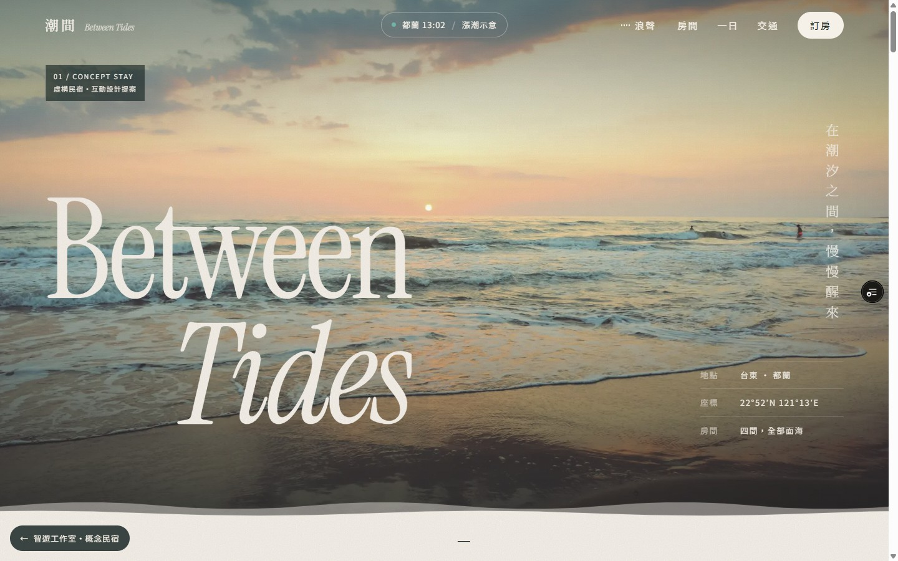
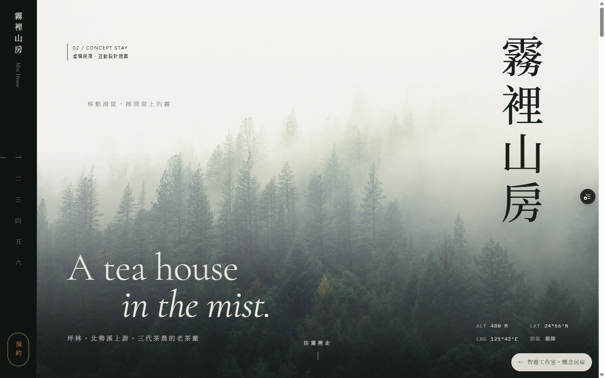

# 潮間與霧裡山房：2026-10-28 預覽驗收

本輪已完成概念文案修正、手機效能調整與雲端預覽驗收。兩個頁面是虛構旅宿的設計作品，不提供真實空房查詢、訂單建立或 LINE 傳送。

## 版本與範圍

- 分支：`feat/bnb-showcase-cases`；[草稿 PR #1](https://github.com/JasonLinn/playwise/pull/1)。未合併 main，未發布正式站。
- 效能與主要互動驗收版本：`8269ffef03c746abd071fc66bf5dfe6eace57c19`。
- 最終程式版本：`021d16859fdc440a8d964cc9b34e36d0ed8db2c7`。追加將房型 CTA 改成「選擇這間房型」，並收緊手機導覽間距，避免「潮間」換行。字型重新產生後無差異；build 再次通過，潮間手機效能另重測三次。
- 最終 [潮間預覽](https://playwise-joaeu99vu-jasonlinns-projects.vercel.app/works/tide)、[霧裡山房預覽](https://playwise-joaeu99vu-jasonlinns-projects.vercel.app/works/mist)。部署 `dpl_4LoXQxjhNGTzzBPCwG6BJkbiyPEE` 已 READY，為 Preview。
- Vercel 部署保護仍開啟。HTTP 使用已授權 connector；瀏覽器使用 Vercel 的限時預覽檢視連結。這份報告不保存分享參數或驗證 token。

## 本輪修改

- 首屏、首頁作品卡、metadata 與頁尾標明概念作品；移除虛構聯絡帳號與登記證號。詢問區說明價格、日期與服務為示意。
- 潮間移除遮擋首屏的開場；海浪、潮位示意與海岸版面保留。潮位不是實測或預報，日出日落為座標估算。
- 霧裡山房保留直排字、霧層、節氣環及泡茶互動；手機停用大範圍模糊動畫與視差。
- 首屏圖片、標題字型預載；字型改用獨立自託管 WOFF2 與小型標題子集，授權文件隨附。手機長頁區段延後排版。
- 新增手機探索選單、區段跳轉、返回作品集與 Escape 關閉。複製訊息狀態跟隨目前選項；失敗時提示手動選取。

## Lighthouse 結果

Lighthouse **12.6.1**、本機 production build、Chrome 模擬手機；不是實體手機量測，也不是 Vercel 網路實測。最終候選版的 devtools 降速各連續測三次，以下列出範圍，不挑最高分。

| 頁面 | 手機 devtools（三次） | LCP 範圍 | TBT 範圍 | 手機 simulated | 桌機 |
|---|---:|---:|---:|---:|---:|
| 潮間 | 92 / 91 / 92 | 2.346–2.460 秒 | 154–210 ms | 96 | 100 |
| 霧裡山房 | 93 / 92 / 93 | 2.397–2.505 秒 | 64–74 ms | 95 | 99 |

潮間 devtools 為最終 `021d168` 的三次重測；其他欄位為 `8269ffe` 候選版量測，霧裡山房之後沒有程式變動。最初潮間 devtools 三次為 92 / 93 / 92，亦保留在資料中。

全部十三次候選與最終重測的 Accessibility、Best Practices、SEO 均為 100；手機 CLS 為 0–0.000127。這是自動工具檢查結果，不等於完整 WCAG 人工認證。

原版 simulated 兩頁均為 96；潮間原版 LCP 抓到的是開場標誌，不能當成實際內容已可閱讀。各種 throttling 方法不可混作同一前後比較，也不以單次分數宣稱普遍提升。

[精簡量測資料與原件 SHA-256](evidence/showcase-20261028/metrics.json)。完整 JSON 留在 repo 工作目錄 `output/showcase-review-20261028/*candidate*.json`，未將大型原始稽核檔加入 Git。

## 互動與畫面驗收

| 檢查 | 結果與證據範圍 |
|---|---|
| 建置與型別 | `npm run build` 通過；包含 Next.js TypeScript 檢查。最終文案、手機導覽修正後再建置通過。 |
| 遠端路由 | 首頁、`/works/tide`、`/works/mist` 皆以授權 HTTP 取得 200；從作品卡進入遠端頁面成功。 |
| 尺寸 | 遠端 Chrome 360、390、768、1440 CSS px 檢查；兩頁未發現文件水平溢出。桌機、平板、手機首屏均人工檢視。 |
| 潮間日期 | 遠端手機選 10/31 入住，切到 11 月選 11/2 退房：2 晚雙人房 NT$10,600（5,800＋4,800），預覽日期與人數正確。 |
| 潮間房型 | 房型展開與連動選擇成功；同日期家庭房 NT$16,400。另於本機驗證 4 人上限、換回雙人房時人數調整及直接修改條件後重新預覽。 |
| 霧裡訊息 | 遠端選立冬、清明雙人房、2 晚：NT$8,400 起，複製成功且標明沒有送出。改成 3 晚後 NT$12,600，複製狀態回到未複製。 |
| 泡茶 | 遠端開始 45 秒、暫停顯示 33 秒、繼續降至 32 秒、重設回 45 秒；減少動態效果下也能開始及重設。 |
| 圖集 | 遠端下一張後 scrollLeft 由 0 移至 278；上一張回到起點附近（平滑捲動中觀測為 6）。 |
| 手機選單 | 兩站可開啟、跳轉區段並自動關閉；Escape 關閉已驗證。最終雲端版 360px 潮間品牌高度 39.59px、行高 39.6px，確認維持單行且未溢出。 |
| 減少動態效果 | 模擬 `prefers-reduced-motion: reduce`，確認標題可見、裝飾動畫停用與選單可操作。驗收後清除瀏覽器模擬設定。 |

未以真實旅宿帳號送訊息、建立訂單或詢問空房；這些不是概念頁的功能。

## 畫面證據

桌機截圖在最後手機間距修正前擷取，桌機樣式未受該修正影響；潮間手機截圖為最終部署。潮間桌機（1440 × 900）：

霧裡山房桌機（1440 × 900）：

手機首屏（390 × 844）：[潮間](evidence/showcase-20261028/tide-mobile.jpg)、[霧裡山房](evidence/showcase-20261028/mist-mobile.jpg)。截圖可能包含 Vercel 預覽工具浮鈕，並非作品介面的一部分。

## 品質判斷與下一輪

兩頁已形成不同的視覺與互動語言：海岸作品用時間、波形與日期選擇；茶山作品用直排、節氣與泡茶節奏。本輪補齊手機導覽及可操作流程，讓視覺效果不再阻礙首屏閱讀。

這是朝得獎作品品質的改善，並不代表已達任何獎項評審門檻。下一輪最有價值的是原創、在地一致的攝影／影片／聲音素材，以及實體 iPhone Safari、Android 中階機和真人使用者驗收。現有 Unsplash 影像不是都蘭或坪林實景；也尚未完成螢幕閱讀器全流程、聽覺音效品質及持續高流量環境測試。

維護方式與素材授權見 [設計說明](showcase-design.md)。
