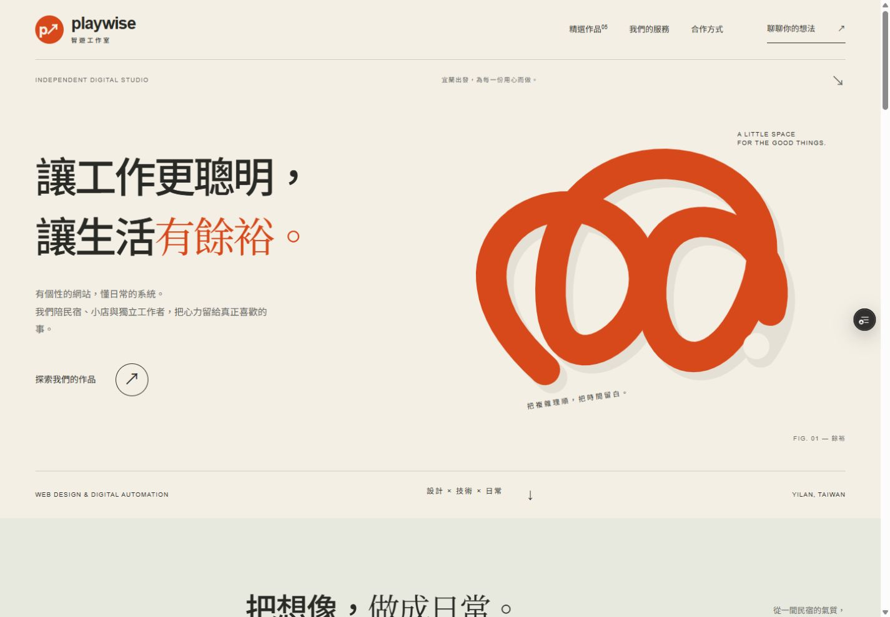
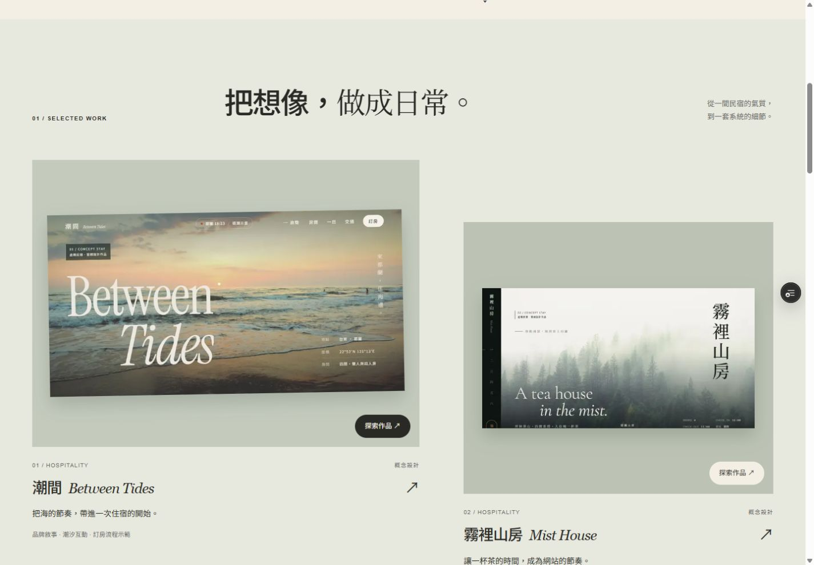
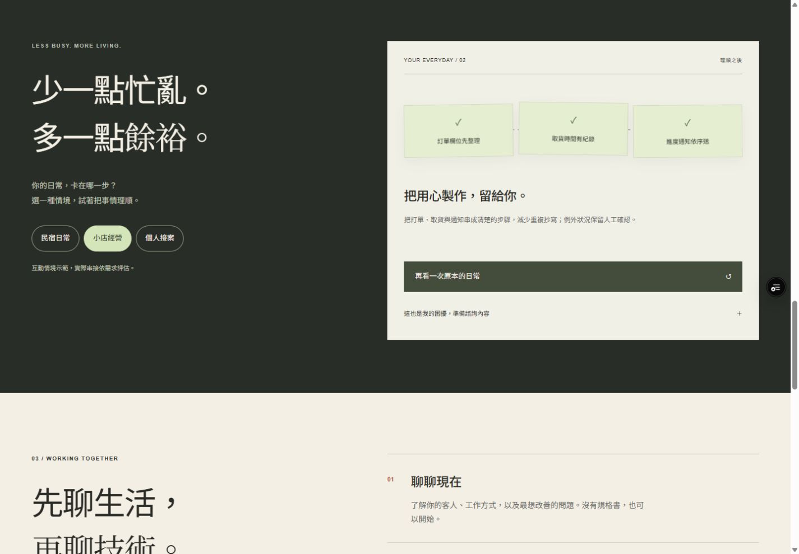

# 智遊工作室官網品質驗收 2026 年 10 月 29 日

新版首頁以「把複雜理順，把時間留白」串起品牌視覺、作品展示與服務體驗。經過排版、手機操作、無障礙、內容可信度及效能的多輪修正，通過本次內部發布驗收。這是 AI 的設計自評與工程驗證，並非 Awwwards、Webby Awards 或 FWA 的評審認證，也不保證得獎。

## 版本與交付

- 最終程式版本：`45d57c48c6b94ffa58039dc47c1877ef8ed088b7`，分支 `codex/studio-quality`。
- [雲端預覽](https://playwise-3ua1dqrlh-jasonlinns-projects.vercel.app)，Vercel 部署 `dpl_HmVh8dQQzEKTU1nFMfV9FZr2hT7y` 已 READY。
- 預覽保護維持開啟；限時檢視連結與驗證資訊不保存在 repo。
- [正式官網](https://playwise-nine.vercel.app/) 的發布結果另記於本文末尾。

## 設計與評選標準對照

參考 [Webby 網站評選標準](https://www.webbyawards.com/judging-criteria/) 的內容、導覽結構、視覺、功能、互動、創新與整體體驗；[FWA 官方回顧](https://thefwa.com/FWA25/25.html) 強調創意、原創與技術表現。Awwwards 的 [G. Colombel Portfolio 2026 官方獲獎頁](https://www.awwwards.com/sites/g-colombel-portfolio-2026) 標示 2026 年 10 月 28 日 Site of the Day，並列出設計 40%、易用性 30%、創意 20%、內容 10% 的評分構成。

另檢視該作品的[實際網站](https://guillaumecolombel.fr/)。它以沉浸式作品切換形成鮮明識別；Playwise 的客群是民宿、小店與獨立工作者，因此以易讀的中文排版、原創線條意象與可操作的工作情境建立自身識別。這是對視覺一致性與體驗完整度的比較，不是套用對方版型或宣稱同等評分。

| 評估面向 | 本版實作與自評 |
|---|---|
| 視覺設計 | 紙色、墨色、朱橘與鼠尾草綠形成固定色彩系統；中西文字級、細線與不對稱作品排版具有一致節奏。首屏 SVG 線條呼應整理工作與保留餘裕的概念。 |
| 品牌與內容 | 首屏明確說明服務與客群；服務描述、合作步驟、常見問題與聯絡方式連成完整敘事。概念作品與示例數據清楚標示，移除無依據的百分比成效與虛構聯絡資料。 |
| 導覽與易用性 | 作品、服務、合作與聯絡入口直接可見；手機選單、返回作品集、頁尾回頂端、跳至主要內容皆有明確落點。 |
| 互動與原創性 | 三種日常情境將散落工作整理為流程，讓訪客親自體驗服務主張；諮詢內容可展開、複製與自行帶到 LINE。動態用於表達狀態，不延遲主要內容閱讀。 |
| 功能完整度 | 五個作品入口保留；原型可完成選衣、日期與付款方式展示。日期前後關係與選擇重設已補正，完成頁不會誤導為真實交易。 |
| 響應式與可及性 | 320 至 1440 CSS px 檢查無文件水平溢出；可用鍵盤與原生選單操作。減少動態效果時停用動畫；首頁主要內容與手機導覽在停用 JavaScript 後仍可讀取、展開。 |
| 工程品質 | 首頁以伺服器元件為主，僅導覽與情境互動需要客戶端狀態；本地作品圖片由 Next.js 最佳化。建置、型別檢查、首頁 Lighthouse 與雲端路由檢查通過。 |

本次自評結論是視覺、內容與可操作性已形成一致的發布版本。真正的獎項競爭力仍需外部評審判斷；以上沒有把效能分數換算成設計獎得分。

## 修正迭代

1. 重新設計首頁，建立專屬色彩、SVG 主視覺、作品敘事、服務與合作流程；加入可互動的日常情境。
2. 第一輪自動檢查指出聯絡區對比與品牌連結可及名稱問題，修正後 Accessibility 從 96 提升至 100。
3. 手機與鍵盤複檢補齊焦點、Escape 返回選單、觸控目標、減少動態效果；複製狀態跟隨情境切換。
4. 修正作品截圖尚未完成進場動畫的畫面、圖片副檔名與實際格式不一致，以及頁尾回頂端的落點。
5. 對照舊作品內容，移除虛構民宿電話、LINE、登記證號與空連結，改為概念作品說明；WashPass 移除未驗證的 80% 與零學習成本等文案。
6. 洗衣原型改用原生按鈕、補上名稱與選取狀態，限制送件日期至少在取件兩日後，改取件日會清空送件日。正式串接能力改為規劃說明。
7. 最終視覺複檢調整首頁簡介斷行，避免短字串獨占一行；重新建置與量測手機首頁。

## 效能量測

Lighthouse 12.6.1，對本機 production build 的 Chrome 模擬量測。不是實體手機、正式站網路或真實訪客的 Core Web Vitals。

| 版本與情境 | Performance | Accessibility | Best Practices | SEO | LCP | TBT | CLS |
|---|---:|---:|---:|---:|---:|---:|---:|
| 最終 `45d57c4` 手機 | 99 | 100 | 100 | 100 | 2.202 秒 | 18 ms | 0 |
| `c884163` 桌機 | 100 | 100 | 100 | 100 | 0.469 秒 | 0 ms | 0 |

桌機量測後的首頁差異只有簡介斷行；舊作品內容另外修正。各次結果、量測時間及原件 SHA-256 見 [metrics.json](evidence/studio-20261029/metrics.json)。完整 Lighthouse JSON 保存在工作目錄 `output/studio-20261029/`，精簡證據隨 Git 保存。首輪不是舊正式站的基準，不用於宣稱改版前後的效能增幅。

## 操作驗證

| 檢查 | 結果 |
|---|---|
| 最終建置 | `npm run build` 通過，包含 TypeScript；沒有把舊版 `next lint` 指令列為通過。現存 Browserslist 資料過期提示不影響此次建置。 |
| 首頁尺寸 | 320、360、390、768、1024、1440 CSS px，文件及抽查文字與控制項無水平溢出；[尺寸資料](evidence/studio-20261029/responsive.json)。 |
| 首頁手機選單 | 滑鼠、Enter、Escape 可操作；關閉後焦點回到選單，點擊服務連結後到達對應區段。 |
| 首頁減少動態 | 系統偏好啟用後，主視覺動畫為 none；情境與常見問題仍可操作。主視覺正常動畫為單次 1.5 秒。 |
| 停用 JavaScript | 手機原生 details 導覽可展開，主要內容與聯絡入口仍可見；互動示範需要 JavaScript。 |
| 情境與諮詢 | 切換三個情境、整理與還原流程、展開諮詢內容可用；複製按鈕呈現成功狀態，切換情境後重設。沒有獨立核對 OS 剪貼簿內容。 |
| 作品導覽 | 雲端從作品卡進入潮間與霧裡山房，返回首頁作品區成功；其他三個作品與圖示路由回應 200。 |
| 洗衣展示 | 最終程式選一件襯衫為 NT$80；取件示範日 3 僅能選示範日 5 送件；改取件日後下一步停用，重選送件日後可完成。完成頁顯示非實際訂單、無扣款與未傳送通知。 |
| 社群分享圖 | `/studio-share` 產生 1200×630 圖片，視覺檢視通過；favicon 可讀取。 |

本輪沒有實體 iPhone Safari、Android 裝置與螢幕閱讀器測試，Lighthouse Accessibility 100 也不等於完整 WCAG 認證。舊作品頁的局部修正沒有宣稱達到首頁同等分數。

## 畫面證據

手機與原生導覽另見 [手機畫面](evidence/studio-20261029/mobile.jpg)、[停用 JavaScript 的選單](evidence/studio-20261029/no-js-menu.jpg)；[洗衣完成示範](evidence/studio-20261029/laundry-demo.jpg) 保留互動結果。

## 發布紀錄

待本次程式審閱與部署完成後補記正式版本及驗證結果。
